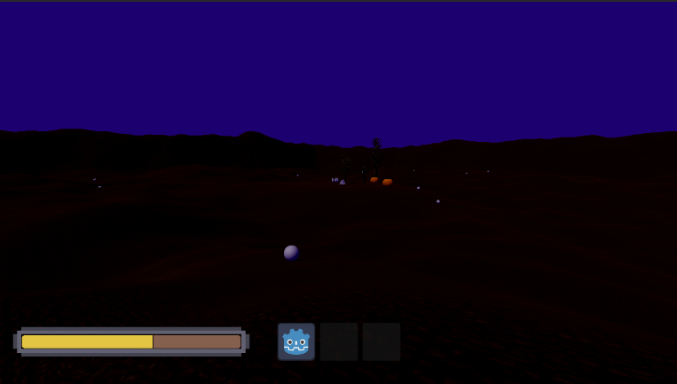

# mouse-owl

a spooky survival game! play as a mouse, gather food, bring it back to your den, and keep your Children alive. made by H.O.N.K. for the GoedWare Halloween Gamejam.

## how do i play?
download the latest windows build [here](https://github.com/HONKgames/mouse-owl/releases/latest) and unzip it.
then just run mouse-owl.exe.

windows may warn you because the exe isn't signed. we promise this is NOT a crypto miner. click more info and run anyway.
also! keep the tree3d dll in the same folder so the trees work!

## controls
- Move with WASD.
- Sprint with Shift.
- Jump with Space.
- Pick up food by holding Left Click.
- Enter or exit your den (the triangular prism) with E.
- Free or capture your mouse with Esc.

## what do you do?
you get hungry and tired as time goes on. your Children also hunger. food spawns around the map daily, so go get that food and feed your mouse family! you've also got to feed yourself, of course. click the eat button in the den. sleep in the den by holding space to lower fatigue. feed your Children by clicking them in the den or pressing the button to feed the hungriest Child.

## who made this?
- RedNinja17 - Programmer
- butteredsaltedtoast - Programmer
- trexhaydor - Programmer
- ScarletMirage - Artist

this is a big work in progress right now.
built with Godot 4.7.